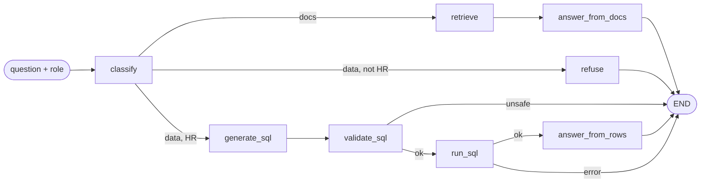

# hr-assistant

A small AI service that sits next to an existing compensation management app and answers HR questions in plain English.

- **Policy questions** ("How many vacation days do I get?") are answered from uploaded policy documents (RAG over pgvector), with sources.
- **Data questions** ("What's the average salary in Sales?") are turned into a single read-only SQL query against the compensation database, but **only for HR users**.

Built with FastAPI, LangChain, LangGraph, Claude (`claude-haiku-5-5`) with Google Gemini as fallback (`gemini-2.5-flash`), Gemini embeddings (`gemini-embedding-001`), pgvector and Postgres.

## Architecture



The flow is a LangGraph `StateGraph` ([app/graph.py](app/graph.py)). Every node reads a shared state (`question, user_role, route, context, sql, rows, answer, sources`) and returns only the fields it changes.

1. **classify**: the LLM returns a structured `RouteDecision` (`"docs"` or `"data"`), so we never have to parse free text.
2. **docs path**: fetch the top 4 chunks from pgvector, then answer *only* from that context. With no context it replies "I don't know" without calling the LLM.
3. **data path**:
   - Non-HR users are refused straight away (role checked in code, not by the LLM).
   - HR users: the LLM writes one SELECT using the live database schema.
   - `validate_sql` parses that query with sqlglot. It rejects anything that isn't a single SELECT (including DELETEs hidden in CTEs and `SELECT INTO`) and adds `LIMIT 100`.
   - The query runs in a `READ ONLY` transaction with a 5-second timeout, using a read-only DB user.
   - The LLM explains the rows in plain English.

**Safety in layers:** read-only DB user, then a read-only transaction, then the AST validator, then the role check, then JWT auth.

**Two databases:** embeddings live in their own `pgvector/pgvector:pg16` container. The compensation DB is only ever read.

### Project layout

```
app/
  main.py          FastAPI endpoints (/health, /ingest, /ask)
  auth.py          JWT verification -> user role
  config.py        Settings from environment variables
  graph.py         LangGraph workflow
  sql_guard.py     SQL safety validator
  comp_db.py       Read-only compensation DB access + schema inspection
  vector_store.py  pgvector (langchain-postgres)
  ingest.py        PDF/TXT -> chunks -> embeddings
  llm.py           Claude chat model (Gemini fallback) + Gemini embeddings
tests/             pytest, all LLM calls mocked
```

## Running it

1. Create a read-only user in the compensation database:

   ```sql
   CREATE USER hr_readonly WITH PASSWORD 'change-me';
   GRANT CONNECT ON DATABASE compensation TO hr_readonly;
   GRANT USAGE ON SCHEMA public TO hr_readonly;
   GRANT SELECT ON employees, salary_records, departments, job_levels TO hr_readonly;
   ```

2. Configure:

   ```bash
   cp .env.example .env   # fill in ANTHROPIC_API_KEY, GOOGLE_API_KEY, the hr_readonly password in DATABASE_URL, JWT_SECRET
   ```

3. Start the vector DB, then the app (Python 3.12):

   ```bash
   docker compose up -d vectordb
   python3.12 -m venv .venv && source .venv/bin/activate
   pip install -r requirements.txt
   uvicorn app.main:app --reload
   ```

   Or run everything in Docker with `docker compose up --build`. In that case, change `localhost` in `DATABASE_URL` to `host.docker.internal`.

   The API runs at http://localhost:8000 (interactive docs at `/docs`).

### Run the tests

```bash
python3.12 -m venv .venv && source .venv/bin/activate
pip install -r requirements-dev.txt
pytest
```

No API keys or databases are needed: the LLM, retriever and SQL runner are all mocked.

## Example requests

Tokens normally come from the compensation app. For local testing, make one with the same secret:

```bash
export TOKEN=$(python -c "import jwt,time; print(jwt.encode({'sub':'me','role':'HR_MANAGER','exp':int(time.time())+3600}, 'YOUR_JWT_SECRET', algorithm='HS256'))")
```

```bash
# Health check
curl http://localhost:8000/health

# Upload a policy document (HR only)
curl -X POST http://localhost:8000/ingest \
  -H "Authorization: Bearer $TOKEN" \
  -F "file=@sample_docs/acme_hr_policy.pdf"
# {"filename":"acme_hr_policy.pdf","chunks":...}

# Policy question
curl -X POST http://localhost:8000/ask \
  -H "Authorization: Bearer $TOKEN" -H "Content-Type: application/json" \
  -d '{"question": "How many sick leave days do I get, and when do I need a medical certificate?"}'
# {"answer":"...","route":"docs","sources":[{"filename":"acme_hr_policy.pdf","chunk":4}],
#  "models":{"classify":"claude-haiku-5-5","answer":"claude-haiku-5-5"}}

# Data question (HR only)
curl -X POST http://localhost:8000/ask \
  -H "Authorization: Bearer $TOKEN" -H "Content-Type: application/json" \
  -d '{"question": "What is the average salary per department?"}'
# {"answer":"...","route":"data","sql":"SELECT department, AVG(amount) ... LIMIT 100",
#  "models":{"classify":"claude-haiku-5-5","generate_sql":"claude-haiku-5-5","answer":"claude-haiku-5-5"}}

# No token -> 401
curl -i -X POST http://localhost:8000/ask -H "Content-Type: application/json" -d '{"question":"hi"}'
```

## Configuration notes

- **Chat models:** Claude, using the key in `ANTHROPIC_API_KEY`.
  - `LLM_FAST_MODEL` is used for classify and both answer steps.
  - `LLM_SQL_MODEL` is used for writing SQL.
  - Both default to `claude-haiku-5-5`, the cheapest option.
- **Fallback:** each Claude model is wrapped with `.with_fallbacks([Gemini])`. If a Claude call still fails after its retries (outage, rate limit, timeout, bad key), Gemini answers the same request instead. `LLM_MODEL` sets the Gemini model; the default is `gemini-2.5-flash`.
- **Seeing which model answered:** every `/ask` response has a `models` field showing which model handled each step (`classify`, `generate_sql`, `answer`). The names come from each LLM response's `response_metadata`. When Gemini takes over, the server log shows a warning, `Claude call failed, falling back to Gemini: <original error>`.
- **Cost limits:**
  - `max_tokens` is 256 for classify and SQL, and 800 for answers.
  - Calls retry 2 times and time out after 30 seconds.
  - Gemini runs at temperature 0. Claude Haiku 5.5 only accepts its default temperature, so none is sent to it.
  - Thinking is off on both models, so the whole token budget goes to the output.
- **Switching `LLM_SQL_MODEL` to a stronger model:** if you pick `claude-sonnet-5-5` or `claude-opus-5-5`, update `thinking` in [app/llm.py](app/llm.py). Those models reject `{"type": "disabled"}`; use `{"type": "between_tools"}` on Sonnet 5.5, or remove the line on Opus 5.5. If you forget, every Claude call fails and Gemini answers instead. You'll see the fallback warning in the log and `gemini-2.5-flash` in `models`.
- **Embeddings:** Gemini (`GOOGLE_API_KEY`), `gemini-embedding-001` at 768 dimensions. If you ever change the embedding model or size, also change `VECTOR_COLLECTION`, because vectors of different sizes can't share a collection.
- "HR users" means tokens whose `role` claim equals `HR_ROLE_VALUE` (`HR_MANAGER` for this compensation app).
- `JWT_ROLE_CLAIM` can point at a string claim (`"role": "HR_MANAGER"`) or a list claim (`"groups": ["HR_MANAGER", ...]`).
- `COMP_TABLES` limits which tables the LLM can see. Leave it empty to expose all tables.

## Known limitations / next steps

- Re-uploading a file overwrites its chunks by id. If the new version is shorter, the extra old chunks stay behind.
- No conversation memory: each question is answered on its own.
- Row-level access (e.g. a manager seeing only their own team) is not implemented. Access is all or nothing per role.
